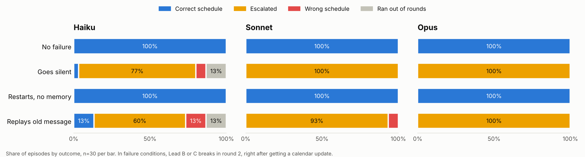

# failure-eval

What happens to a team of LLM agents when one of them breaks partway through a task? This takes the question from my multi-agent RL research and applies it to Claude agents.

Three leads schedule 5 meetings into 8 slots, and each one can only see its own team's calendars. Lead A coordinates and can either submit a schedule or escalate to a human. In round 2 every lead gets a calendar update, and lead B or C breaks right when it should share its update. Every instance is filtered so a schedule built without the lost update is probably wrong. The failure modes:

- silent: stops posting
- restart: comes back with its notes but no memory of the chat
- replay: keeps reposting its round 1 message

## Results

360 episodes (30 instances, 4 conditions, Haiku, Sonnet and Opus 5.5 at low effort), about $45.



- Every model solved every baseline instance.
- Agents almost always noticed the failure, flagging it in 87 to 100% of episodes.
- They booked a wrong schedule 8 times in 180 failure episodes. In 4 of those, the coordinator had already flagged the problem and submitted anyway on the last round.
- Replay caused 6 of the 8 wrong bookings, silent caused 2, and restarts caused none. Twice, a replayed message happened to confirm the current plan and the coordinator counted it.
- All 8 wrong bookings missed the failing lead's update and had no other errors.
- Opus never booked a wrong schedule and usually escalated before the final round. Sonnet and Haiku almost always waited for the last round, where 5 of the 8 wrong bookings happened.

Full numbers are in results/episodes_summary.csv and transcripts are in results/episodes_examples.md.

## Running it

```
pip install -r requirements.txt
export ANTHROPIC_API_KEY=sk-ant-...
python run.py --smoke    # 1 instance per model, prints a cost estimate
python run.py            # full run, stops at --budget (default $60) and resumes if rerun
python analyze.py        # summary, chart, example transcripts
```

`python run.py --mock` runs offline with a fake model, and `python -m tests.test_all` runs the tests.

## Limitations

This is a small test. It's one task, only Claude models, and 30 episodes per condition. There were just 8 wrong bookings total, so I wouldn't read too much into replay causing more of them than silent yet. An LLM judge decided when a failure counted as noticed, so those numbers could be off too.

It's also probably too easy. The round 2 notice tells everyone an update is coming, so a missing one stands out, and Sonnet and Opus handle that almost perfectly. I want to try a version without the notice, and one where escalating has a cost, to see if the stronger models start to pull apart.
